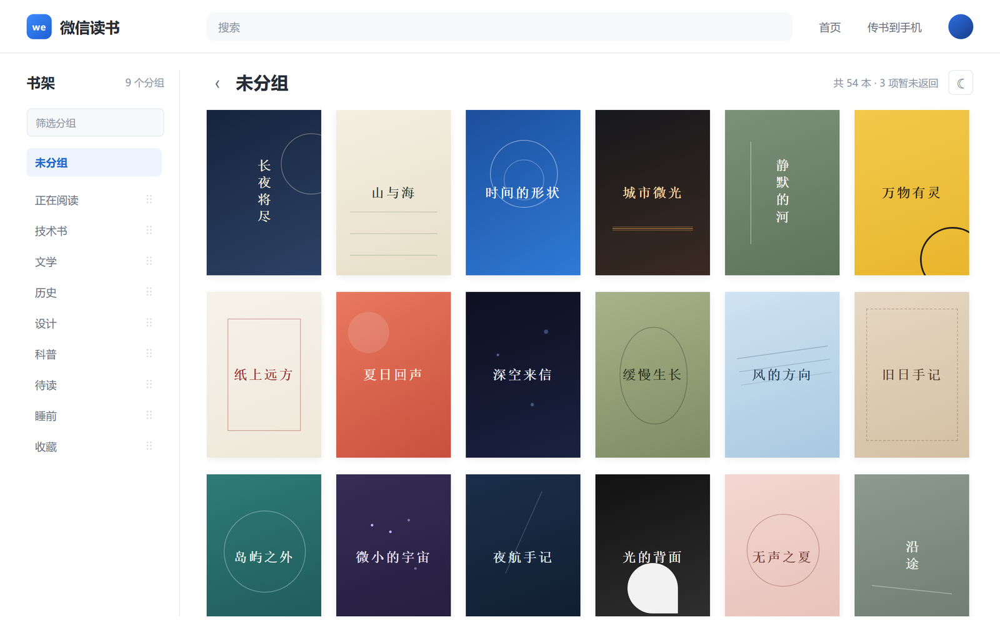
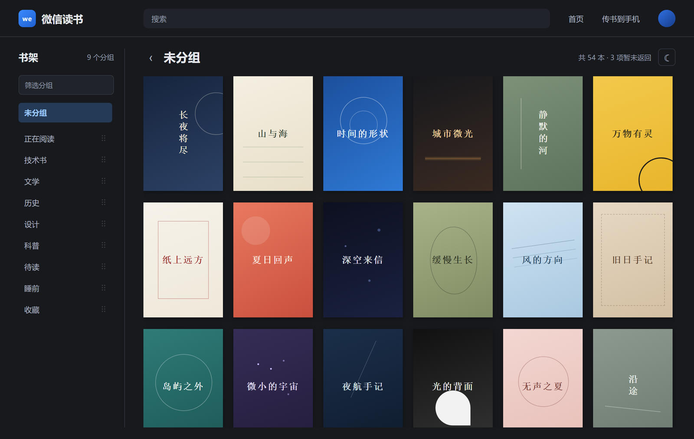

# 微信读书 · 清爽书架

[](https://github.com/xrt-wg/weread-clean-shelf/actions/workflows/ci.yml)

非官方 Tampermonkey 用户脚本，把微信读书网页版书架重排为「左侧分组 + 右侧纯封面」的阅读型界面。

- 左侧分组列表、筛选，以及固定顶部的“未分组”入口。
- 分组可自由拖动排序，靠近边缘自动滚动；也支持 `Alt + ↑ / ↓`。
- 页内切换分组，不整页刷新，并保留各组的浏览位置。
- 纯封面网格，悬停显示书名；可折叠侧栏，支持浅色／暗色主题。
- 紧凑顶栏，移除会员、下载提示及墨水屏版、手机版入口。
- `document-start` 提前加载增强层；请求失败或等待超时自动恢复原书架。

只调整页面呈现，**不修改原站分组、书籍归属或阅读权限**，也不上传书架或账号数据。

> 本项目为个人维护的非官方工具，与微信读书 / 腾讯无关。原站接口或页面结构变化后，脚本可能失效。

## 预览

| 浅色 | 暗色 |
| --- | --- |
|  |  |

> 界面示意，使用示例数据，不含个人书架内容。

## 安装

1. 在浏览器安装 [Tampermonkey](https://www.tampermonkey.net/)（Chrome / Edge / Firefox 均可）。
2. 打开安装地址：

   <https://raw.githubusercontent.com/xrt-wg/weread-clean-shelf/release/src/weread-shelf.user.js>

   Tampermonkey 会弹出安装页。如果浏览器直接显示了源码，把全文复制到 Tampermonkey 的「新建脚本」中保存即可。
3. 打开并刷新 <https://weread.qq.com/web/shelf>。
4. 想退出体验时，在 Tampermonkey 中停用或删除该脚本。

Chrome 138 及以上版本可能需要在扩展详情页中开启「允许用户脚本」。

> 如果你之前安装过本地 1.0.0 版本，脚本的 `@namespace` 已改为 GitHub 地址。建议先在 Tampermonkey 中删除旧脚本，再安装新版，避免两个同名脚本同时运行。

## 更新

脚本头包含 `@updateURL` / `@downloadURL`，指向 `release` 分支的正式文件。Tampermonkey 会定期检查更新，也可以在脚本详情页手动点「检查更新」。

也可以重新打开上面的安装地址覆盖安装。更新不会清除本机保存的主题、折叠状态和分组顺序。

## 卸载

在 Tampermonkey 中删除「微信读书 · 清爽书架」。如需一并清除本机偏好，可在微信读书页面控制台执行：

```js
localStorage.removeItem('wr-rea-shelf-preferences');
localStorage.removeItem('wr-rea-group-order');
sessionStorage.removeItem('wr-rea-shelf-positions');
```

## 隐私与权限

- 正式版声明 `@grant none`，不申请额外网络权限。
- 只读取当前登录状态下的同源只读书架接口（`/web/shelf/sync` 等），用于生成封面视图。
- 主题、折叠状态和分组顺序只保存在本浏览器的 `localStorage` / `sessionStorage`。
- 开发预览版才会使用 `GM_xmlhttpRequest` 访问 `127.0.0.1`，且仅在显式开启时启用；正式版不含这段逻辑。

## 使用说明

- **拖动排序**：按住分组名拖动，松开后保存到本浏览器；“未分组”始终固定在顶部。
- **键盘排序**：聚焦分组后按 `Alt + ↑ / ↓`。
- **筛选**：左上角输入框按名称过滤分组，不影响书籍数据。
- **折叠 / 主题**：标题栏右侧的两个图标按钮，选择保存在本机。
- **未分组**：指书架索引中不属于任何分组的书，不是“全部书籍”。分组页仍沿用原站书籍归属。

## 开发命令

需要 Node.js 20 或更高版本，无第三方 npm 依赖，不需要先执行 `npm install`。

```sh
npm run build   # 生成可全文复制的独立正式脚本
npm test        # 运行构建、数据模型、启动与恢复测试
npm run check  # 构建、测试、生成文件语法检查
```

版本号只维护 `package.json`，构建时自动写入脚本头部和运行时。

| 文件 | 用途 |
| --- | --- |
| `src/weread-shelf.user.js` | 默认交付文件，由构建生成并纳入版本库 |
| `src/shelf-gallery.js` | 界面与交互源码 |
| `src/shelf-model.mjs` | 书架整理、排序和原站链接编码 |
| `src/userscript-bootstrap.js` | 正式脚本启动模板 |
| `src/development-updater.js` | 仅开发预览版包含的可选更新逻辑 |
| `scripts/build-userscript.mjs` | 统一构建入口 |
| `tests/` | 自动化检查 |

## 可选自动预览：默认关闭

仅在需要连续调整界面时使用：

1. 运行 `npm run preview`，启动只监听本机的服务，并生成 `src/weread-shelf.dev.user.js`。
2. 将开发预览版全文覆盖到同一个 Tampermonkey 脚本。
3. 在当前书架地址后加 `?rea-dev=1` 显式启用。服务按请求组装最新源码，修改后无需重复安装。
4. 使用 `?rea-dev=0` 并刷新可关闭当前标签页自动更新。完成体验后，再用正式脚本覆盖并停止服务。

开发预览版的端口只在启动服务时确定；服务重启后需要重新复制开发预览版。此限制不影响正式脚本的自动更新流程。服务只提供代码，不接收书架或账号数据。

## Git 与发布

- `develop`：后续日常开发分支。
- `release`：已确认的稳定版本分支，也是 GitHub 默认分支和自动更新的来源。
- `v1.0.0`：第一版稳定发布的附注 Tag。后续按 `v主版本.次版本.修订版本` 命名。

日常在 `develop` 小步提交。确认发布后，在 `develop` 更新版本、运行检查并提交，将 `release` 快进到该提交，再添加对应附注 Tag。两个分支不得直接重写已发布历史。

推送 `v*` tag 后，GitHub Actions 会自动完成剩余发布步骤：

- `CI`：push 到 `develop` / `release` 或提交 PR 时，构建、测试，并检查生成脚本是否已提交。
- `Release`：校验 tag 与 `package.json` 版本一致，重新构建，并把 `weread-shelf.user.js` 上传到对应 Release。

回退时从上一发布 Tag 取出正式脚本，全文覆盖已安装脚本即可，不必回退用户的本机偏好。

## 已知边界

- 增强依赖已观察到的只读书架接口、页面类名和分组路由；上游变化后需要重新核查。
- 数据在页面初始化时读取，刷新后重新获取；接口未返回的条目会提示数量，不认定为已删除。
- 阅读页的进一步个性化留待后续。
- 分析摘要和各轮记录位于 `analysis/*.md`，REA 初始摘要见 `analysis/rea-initial/FINDINGS.md`。原始抓取、完整分析大文件、截图、临时服务信息和旧实验代码保留在本机，均不纳入版本库。

## License

[MIT](LICENSE) © 2026 Kaven
